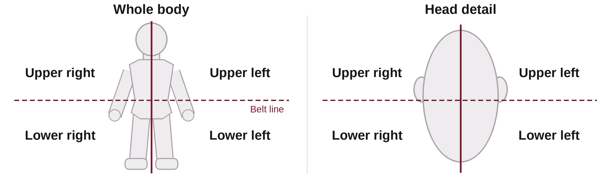

# Meyer Longsword Basics

[← All classes and lessons](index.md)

## The Four Openings

Meyer divides the body down the middle and across the belt. That gives an upper and a lower opening on each side. He uses the same four-part division for the head itself.

Both views face the fencer. Their right is on your left. The openings describe locations, not a list of permitted targets.

## The Four Principal Cuts

Arrows show blade travel. The diagonal and horizontal examples can be mirrored.

| **Cut**       | **English name** | **Blade path**                              |
|---------------|------------------|---------------------------------------------|
| **Oberhau**   | High Cut         | Straight down, like 12 to 6 on a clock.     |
| **Zornhau**   | Wrath Cut        | Diagonally down, like 2 to 8 or 10 to 4.    |
| **Mittelhau** | Middle Cut       | Horizontally across, from either side.      |
| **Underhau**  | Low Cut          | Diagonally up from below, from either side. |

**Oberhau and Zornhau.** Both descend. In Meyer’s list, Oberhau names the vertical path and Zornhau the diagonal. In broader German fencing usage, Oberhau can mean any cut from above.

## Parries and Covered Cuts

A parry wards off an incoming cut. Start by asking which of your openings is threatened. Choose an action that closes the path of the incoming blade; Meyer’s four openings are not four prescribed parries.

**Parry then answer.** Catch or send the blade aside, then make a separate return cut if there is an opening. A cut used only to displace the blade still counts as the parry, not the answer.

**Parry and strike together.** The same cut closes the incoming line and reaches an opening. Meyer distinguishes this from merely parrying. If the incoming cut can still land, deal with it first.

### Three Defensive Examples

These are useful starting examples from Meyer’s guards and cuts, not his own numbered list of basic parries.

| **Example**         | **What it does**                                                                                              | **Timing**                  |
|---------------------|---------------------------------------------------------------------------------------------------------------|-----------------------------|
| **Hanging cover**   | Receive a high cut on a sloping blade. Hangetort (Hanging Point) is a guard shape you can use for this cover. | Parry, then answer.         |
| **Cut to displace** | Use an Oberhau or Zornhau to send the incoming blade off its line. Look for the opening it leaves.            | Parry, then answer.         |
| **Covering cut**    | A Zwerchhau (Thwart Cut) can cover against a high cut while your own cut reaches an opening.                  | Defend and strike together. |

### Quick Review

**Name the opening.** Face a partner and point out their upper right and your upper right. Then identify the upper and lower openings on the head.

**Show the angle.** Trace the four paths with clear space and no contact. Compare the vertical Oberhau to the diagonal Zornhau at the same speed.

**Check the cover.** In slow partner work, distinguish a parry followed by a cut from a cut that covers as it lands. Use club-approved training swords, protective gear, and permitted targets.

### Historical Source

Joachim Meyer, *Gründtliche Beschreibung der Kunst des Fechtens* (1570), Book 1 (Sword), ch. 1 (openings), ch. 3 (guards), ch. 4 (cuts), and ch. 5 (parrying). [English translation on Wiktenauer](https://www.wiktenauer.com/wiki/Joachim_Meyer).
