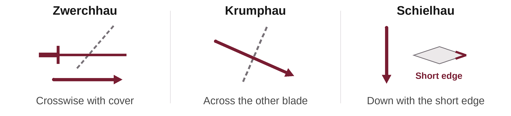
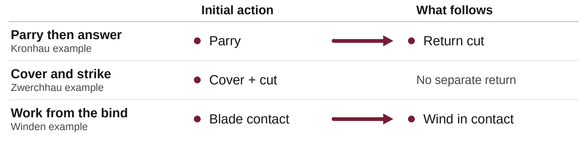

# Meyer Longsword Cuts and Parries

[← All classes and lessons](index.md)

The four openings stay the same. Name upper or lower and the fencer’s own left or right, on the body or on the head. For the cuts in this review, the path alone won’t always tell you which action you’re seeing.

## Four Named Cuts

These are four examples from Meyer’s chapter on cuts. A named cut can still be one action. Watch how the blade turns, how it meets the other blade, and whether the reply is a separate movement.

The diagrams show features, not exact positions. Dashed gray lines represent the other blade’s line.

| Cut | What to look for | How to tell it apart |
| --- | --- | --- |
| Zwerchhau Thwart Cut | A crosswise cut. In the high form, the raised hilt helps cover a descending line. | Mittelhau describes the horizontal path. For this Zwerchhau, also look at the hilt and the line it covers. |
| Krumphau Crooked Cut | The blade crosses the opposing blade’s line. Meyer describes a crossed-hand form. | A diagonal path alone doesn’t identify it. Watch where the blades cross. |
| Schielhau Squinting Cut | A descending cut that turns to use the short edge. | It can look like an Oberhau by direction. Watch which edge leads. |
| Kronhau Crown Cut | A high catch receives a descending cut, followed by a return cut in Meyer’s example. | The cover and return are separate actions in this example. |

**Long edge and short edge.** In a conventional grip, the long edge is on the knuckle side of the forward hand. The short edge is the opposite edge.

## Parry Timing and the Bind

Meyer distinguishes a parry that only wards off a cut from one that wards it off and strikes in the same action. If the blades stay in contact, you can also work from that contact, called the bind.

Read each row from left to right. A separate reply doesn’t require a pause.

**Parry then answer.** In the Crown Cut, the catch protects first and the return comes separately. A Crooked Cut that only sends the other blade aside also counts as a parry. Any reply is a separate action.

**Cover and strike.** The Thwart Cut can protect and strike in the same action. If the incoming cut can still land, the motion didn’t close that line.

**Work from the bind.** Winden (Winding) turns the sword while the blades stay in contact, changing their angle or leverage. Meyer discusses it among the handworks, not as a third kind of parry.

### Quick Review

In a slow demonstration, name the opening first. Then compare a high Zwerchhau with a simple horizontal cut: what does the hilt position change? Finally, look at the timing. Did the reply follow the parry, arrive in the same action, or begin from blade contact?

For partner practice, use club-approved training swords, required protective gear, permitted targets, and a pace both fencers can control.

### Historical Source

Joachim Meyer, *Gründtliche Beschreibung der Kunst des Fechtens* (1570), Book 1 (Sword), chs. 1–2 (openings and edges) and chs. 4–6 (cuts, parries, and handworks). [English translation on Wiktenauer](https://www.wiktenauer.com/wiki/Joachim_Meyer).
