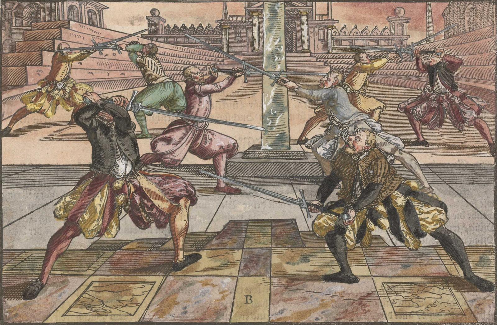
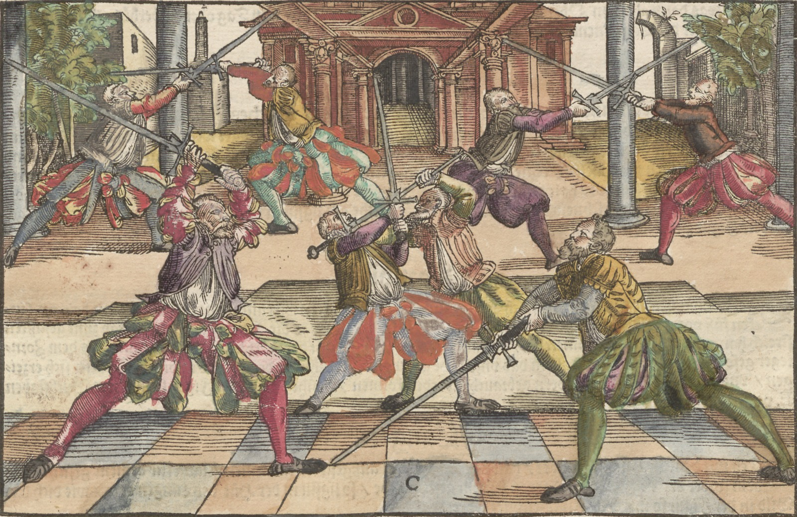
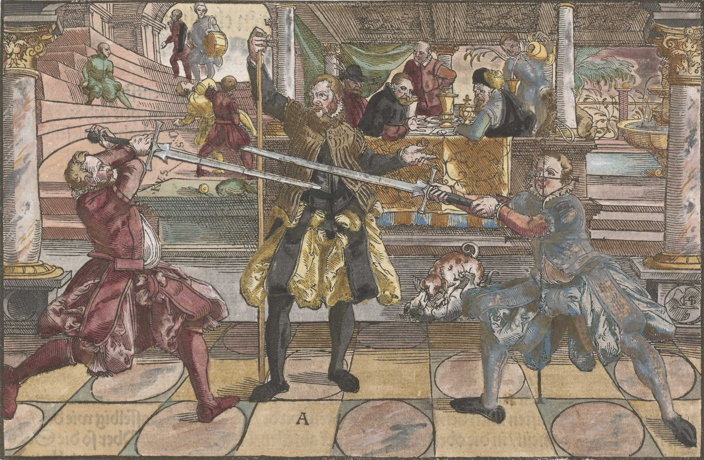
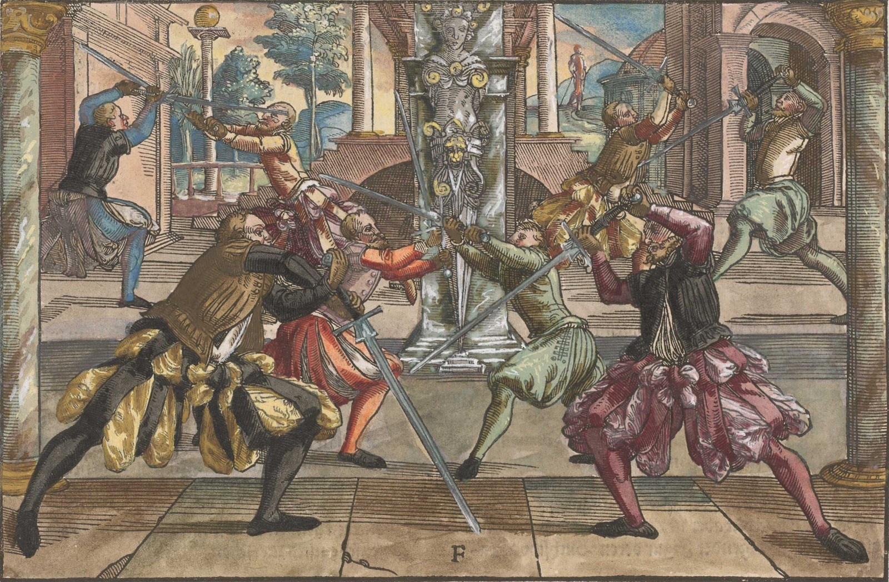
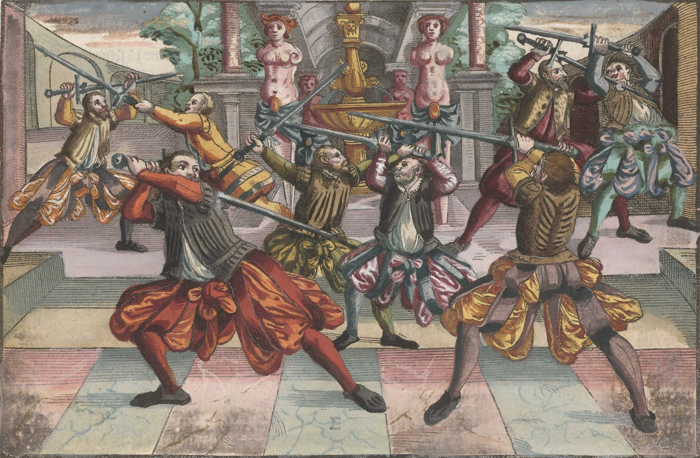
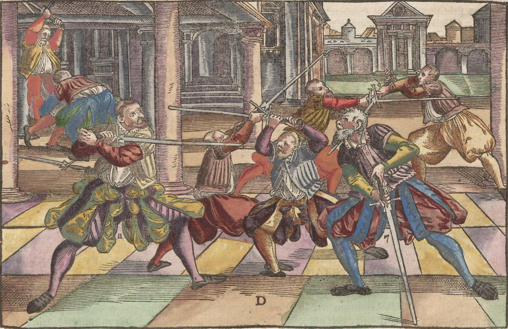

# Meyer Longsword Guards

[← All classes and lessons](index.md) · [Guards with a Purpose I: lesson plan](guards-with-a-purpose-i.md)

## What is a guard?

A guard is an arrangement of the whole body and sword from which a fencer can act. It is not just a blade angle, a promise of protection, or a pose that must be held until the opponent attacks. Meyer describes positions for awaiting and engaging an opponent, and later explains how guards occur within cuts and other work. [S1]

For practice, ask four questions: **What can I threaten? What am I offering? What answer is available? Can I move from here without rebuilding my position?** Those questions are our coaching framework, not a quotation from Meyer.

**A guard is not a parry.** A guard is a position; a parry is an action that deals with a threat. A hanging-shaped blade that misses the incoming line has not successfully parried. An extended point that neither threatens nor constrains the opponent is not automatically controlling the center.

## How to read the diagrams

These are the original woodcuts from Meyer's 1570 book, reproduced from the historical hand-colored scans linked in [S3]. The complete plates retain their letter, background figures, and original body and hand positions. Captions identify the relevant **foreground** fencers; left and right in a caption mean the reader's view, while the formation descriptions use the fencer's own sides.

Read the pictures alongside Meyer's descriptions. A plate is not an exact technical blueprint: Meyer himself says that the arms in the Hanging Point illustration should be more extended. The book does not provide a separate labelled portrait for every guard in this catalogue, so Nebenhut and Eisenport remain explained in words rather than supplied with invented drawings. [S1]

> **Safety** A historical point-to-face description is not a partner-drill instruction. Use approved protection, controlled trainers and contact, and instructor-set targets. Do not let someone enter onto a rigid extended point. Learn shapes in clear solo space before adding a live partner.

## The four principal guards

In the opening of chapter 3, Meyer names Ochs, Pflug, Tag, and Olber as the four principal guards. The remaining guards arise from them in his account. Principal does not mean “the only useful four” or a four-way defensive system. [S1, fols. 5r–5v]

*Figure 1. Plate B — Ochs at foreground left; Pflug at foreground right. Compare the high and low hilt positions.*

*Figure 2. Plate C — Tag at foreground left; Alber at foreground right. Compare the upright sword above the head with the low point in front.*

| Guard | Formation landmarks in Meyer | Do not confuse it with |
| --- | --- | --- |
| **Ochs — Ox** | Right Ochs: left foot forward, hilt high beside the right side of the head, point toward the opponent's face. Left Ochs reverses those sides. | Tag: Ochs presents the point forward rather than straight up. |
| **Pflug — Plow** | Meyer describes right Pflug with the right foot forward, hilt beside the forward knee, point rising toward the opponent's face; left Pflug uses the left foot forward. | Every tradition's version of a hip-height guard. Follow this source rather than importing another author's foot rule. |
| **Tag — Day / High Guard** | Left foot forward, sword above the head, point upright. Meyer also uses the name Oberhut. | Zornhut: Meyer's described Zornhut rests at the shoulder with the blade behind, not upright over the head. |
| **Alber — Fool** | Written Olber in the text: left foot forward, point extended low in front of the forward foot, short edge up and long edge down. | A guarantee of a successful invitation. A low position still needs a timely answer. |

These are paraphrased source landmarks, not exhaustive modern stance prescriptions. Meyer's conclusion allows work on both sides, although individual descriptions often show only one. [S1, fols. 6v–7v; 9v–10r]

## Longpoint and Hanging Point

These two secondary guards are especially useful for naming positions students already encounter while cutting, covering, and recovering. [S1, fols. 7v; 9r]

*Figure 3. Plate A — Longpoint is shown by the foreground fencer on the left, with arms and sword extended toward the opponent.*

| Guard | Recognition | What matters in use |
| --- | --- | --- |
| **Langort — Longpoint** | Arms extended before the face; point toward the opponent's face; Meyer's described example has the left foot forward. | Extension needs a relationship to the opponent. Do not lock the arms and wait to be struck around or displaced. |
| **Hangetort — Hanging Point** | Right foot forward in the described example; arms extended forward at face height, blade hanging downward. Meyer cautions that the plate's arms are not extended enough. | It is a recognizable position, not proof that the incoming cut is caught. Cover the actual line and remain able to answer or leave. |

*Figure 4. Plate F — Schrankhut at foreground left; Hanging Point at foreground right. Meyer explicitly corrects the Hanging Point picture: the arms should extend farther forward. [S1, fol. 9r]*

You may encounter spellings such as Hängenort or Hengetort in other material. This page uses **Hangetort**, following the chapter heading. Naming differences do not remove the need to check the actual position and action.

## The other secondary guards

The formation column summarizes chapter 3. The final column gives modern practice questions—not a claim that Meyer assigns one fixed tactical job to each guard. [S1]

| Guard | Formation landmarks | Question to test in practice |
| --- | --- | --- |
| **Zornhut — Wrath Guard** | Left foot forward; sword at the right shoulder with the blade hanging behind, prepared for a cut. | Can the prepared cut arrive without an extra windup, and can I still defend a different attack? |
| **Wechsel — Change** | Right foot forward; point/weak extended low beside the body, short edge toward the opponent. | Can I rise or change from this endpoint without first collecting the sword? |
| **Nebenhut — Side Guard** | Left foot forward; sword low beside the right side, point to the ground, pommel up, short edge toward the fencer. | Is my rising action ready, or am I only leaving my upper opening available? |
| **Eisenport — Iron Gate** | Right foot forward; hands/hilt low before the knee, arms hanging down; point rises toward the opponent's face. | Is the blade actually between me and the relevant threat? |
| **Schlüssel — Key** | Left foot forward; crossed hands and hilt before the chest; short edge lies over the left arm, point toward the opponent's face. | Can I leave this chamber smoothly without trapping my wrists or gloves? |
| **Einhorn — Unicorn** | Left foot forward; crossed hands raised toward the right, point projecting upward and outward. | Does this high position leave me a useful next action rather than an uncomfortable hold? |

**Wechsel is not simply Nebenhut with another name.** Both can look low in a sketch; compare the side, lead foot, and short-edge orientation in the descriptions. Likewise, a familiar shoulder guard from another tradition is not automatically Meyer's described Tag.

*Figure 5. Plate E — Zornhut at foreground left; Einhorn at foreground right. Compare the sword chambered behind the shoulder with the raised crossed hands and upward point.*

*Figure 6. Plate D — Schlüssel at foreground left; Wechsel at foreground right. Compare the crossed-hand chest position with the low side position.*

## Iron Gate and Crossed Guard are different

Meyer explicitly separates **Eisenport** from **Schrankhut**, despite reporting that people confuse them. Iron Gate has a rising point; Schrankhut has crossed hands and a point directed to the ground. The similar names and low hands are not enough to identify them. [S1, fol. 8r]

See **Figure 4 (plate F)** above for Schrankhut at foreground left. Eisenport is described in the text; do not identify the point-down Schrankhut as Iron Gate.

**Why the lists sometimes differ:** The introductory list in the book includes Brechfenster and Schrankhut among the secondary guards. Chapter 3's opening list instead includes Nebenhut and Hangetort. Chapter 3 then discusses Schrankhut while distinguishing it from Eisenport. This sheet follows the chapter's four-plus-eight list and adds that comparison; it does not pretend every list in the book is identical. Brechfenster is noted here as a list variation, not supplied with an invented standalone posture. [S1; S2]

## Look-alike guards: what actually changes?

Use the point direction first, then the hands' height and relation to the body, then hand crossing and edge orientation. A single feature is rarely enough. These comparisons summarize the descriptions above, not a new catalogue of guard-breaking techniques. [S1]

| Similar guards | The useful distinction | Quick check |
| --- | --- | --- |
| **Ochs and Einhorn** | Both can put the hands high on a side. Ochs directs the point forward toward the face; Einhorn raises crossed hands to the right with the point up and outward. | Is the point presented forward, or lifted upward? |
| **Ochs and Hangetort** | Ochs places the hilt high beside the head. Hangetort extends the hands forward at face height while the blade hangs down. | Are the hands beside the head or reaching in front, and where is the point? |
| **Tag and Zornhut** | Meyer's described Tag is above the head, point upright. Zornhut is at the right shoulder, blade hanging behind. | Above the head, or chambered at the shoulder? |
| **Pflug and Eisenport** | Both are low, rising-point positions, and their outlines can overlap. Meyer describes Pflug's hilt beside the forward knee; Eisenport's hilt before the knee with the arms hanging down. | Beside or before the knee? Do not invent a large difference in point height to separate them. |
| **Pflug and Schlüssel** | Both can present the point forward. Pflug's hilt is low beside the knee; Key's crossed hands are before the chest, with the short edge over the left arm. | Knee-height preparation, or a crossed-hand chest chamber? |
| **Alber, Wechsel, and Nebenhut** | Alber extends the point low in front, short edge up. Wechsel is low beside the body, short edge toward the opponent. Nebenhut's described example is beside the right side, short edge toward the fencer. | Front or side, then which way is the short edge facing? |
| **Eisenport and Schrankhut** | Eisenport's point rises from low hands; Schrankhut's crossed hands carry the point down. | Point up or down, and are the hands crossed? |

Do not turn a flowing transition into an argument over the exact frame at which one name becomes another. Use the descriptions to recognize meaningful relationships, and acknowledge overlap when the source does not give a sharp boundary.

## Guards happen during actions

Meyer describes a descending cut passing from **Tag through Langort to Alber**, and a diagonal cut passing from **Zornhut through Langort to Wechsel**. These examples explain how named positions relate within movement. They are not orders to pause at each checkpoint or finish every tournament cut on the ground. [S1, fols. 9v–10r]

A guard can therefore be a starting position, a moment within an action, or the position from which the next decision begins. What follows depends on the opponent. If a cover is required before the illustrated endpoint, cover; if the opponent is no longer reachable, recover or leave. Do not continue a classroom path just to complete its names.

## Using guards efficiently in competition

The following are Steel Crown applications to modern cut-based practice, not historical guard-breaking rules or guarantees.

| Job | Useful test | Common failure |
| --- | --- | --- |
| Prepare a threat | Can a credible action begin without a separate reload? | Choosing a dramatic position that adds unnecessary preparation. |
| Shape the opponent's choice | Does the apparent opening produce an identifiable response? | Assuming the opponent must attack the offered target. |
| Preserve an answer | Can I deal with a different attack or disengage safely? | Calling a vulnerable position an invitation without having an answer. |
| Connect actions | Does the finish leave another useful threat, cover, or exit? | Returning to a favorite guard automatically while the opponent attacks. |

Read the guard together with measure, blade relationship, and movement. It suggests possibilities; it does not reveal a guaranteed next technique. Holding still can sometimes serve a purpose, and changing can sometimes serve a purpose. Neither stillness nor constant motion is the objective.

## Quick review

- Show the four principal guards and identify the hilt and point landmarks.
- Explain why Ochs is not Tag, and why Iron Gate is not Crossed Guard.
- Trace a slow solo cut and name a guard it passes through without pausing there.
- With an equipped partner at safe distance, identify one opening you appear to offer and an alternative response you must still handle.

For live practice, use the linked [lesson's guard experiments and games](guards-with-a-purpose-i.md#game-1-make-it-earn-its-place). A cuts-only game cannot test the point's scoring threat in the same way as a ruleset that permits thrusts. This reference alone is not permission to experiment with unprotected partner attacks.

## Sources and diagram credit

**[S1]** Joachim Meyer, *Gründtliche Beschreibung der Kunst des Fechtens* (1570), longsword, chapter 3, fols. 5r–10r. Original German descriptions and guard-transition passages, consulted alongside Rebecca L. R. Garber's English translation: [Chapter 3: The Guards](https://sprechfenster.org/meyer/1570/longsword-chapter-3-the-guards/), accessed November 18, 2026. Formation landmarks are independent concise paraphrases of the historical descriptions; no translated passage is reproduced.

**[S2]** Meyer, same work, longsword introduction, fol. 2r, principal/secondary guard list: [Introduction and Contents](https://sprechfenster.org/meyer/1570/longsword-introduction-contents/), accessed November 18, 2026. Compare this list with the chapter 3 list before combining catalogues from different sections or manuscripts.

**[S3] Original illustrations:** Joachim Meyer, *Gründtliche Beschreibung der Kunst des Fechtens* (Strasbourg, 1570), longsword plates A–F. Historical woodcuts, public domain; historical hand-colored scans from [Diestro / Sprechfenster’s chapter 3 edition](https://sprechfenster.org/meyer/1570/longsword-chapter-3-the-guards/), accessed November 18, 2026. Direct scan links: [A](https://sprechfenster.org/scans/meyer/Meyer_1570_Sword_A.png), [B](https://sprechfenster.org/scans/meyer/Meyer_1570_Sword_B.png), [C](https://sprechfenster.org/scans/meyer/Meyer_1570_Sword_C.png), [D](https://sprechfenster.org/scans/meyer/Meyer_1570_Sword_D.png), [E](https://sprechfenster.org/scans/meyer/Meyer_1570_Sword_E.png), [F](https://sprechfenster.org/scans/meyer/Meyer_1570_Sword_F.png). Scans are encoded as JPEG for website delivery, with no cropping, redrawing, or recoloring. Figure numbering and identifying captions are modern Steel Crown additions outside the images. Source files, dimensions, and checksums are recorded with the website assets.
