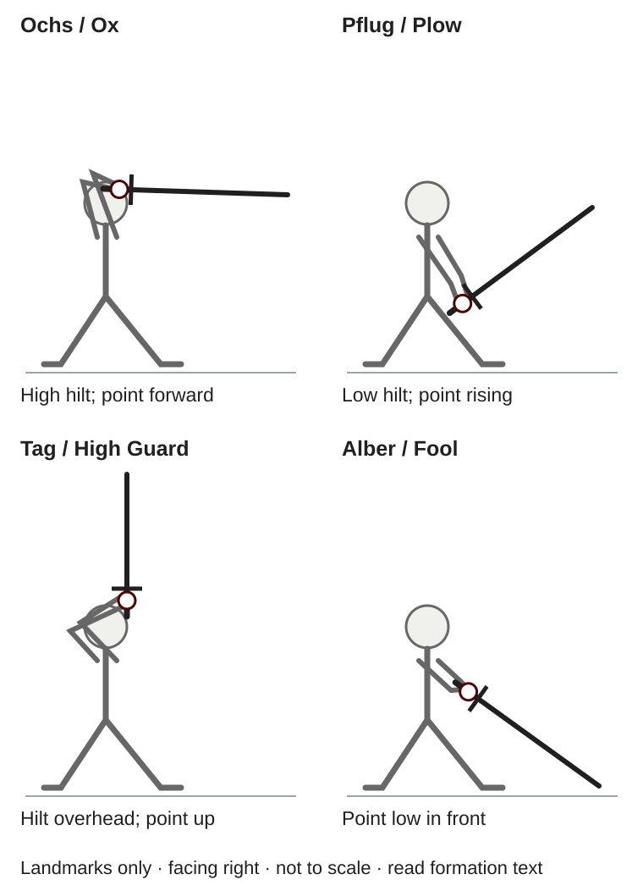

# Meyer Longsword Guards

[← All classes and lessons](index.md) · [Guards with a Purpose I: lesson plan](guards-with-a-purpose-i.md)

## What is a guard?

A guard is an arrangement of the whole body and sword from which a fencer can act. It is not just a blade angle, a promise of protection, or a pose that must be held until the opponent attacks. Meyer describes positions for awaiting and engaging an opponent, and later explains how guards occur within cuts and other work. [S1]

For practice, ask four questions: **What can I threaten? What am I offering? What answer is available? Can I move from here without rebuilding my position?** Those questions are our coaching framework, not a quotation from Meyer.

**A guard is not a parry.** A guard is a position; a parry is an action that deals with a threat. A hanging-shaped blade that misses the incoming line has not successfully parried. An extended point that neither threatens nor constrains the opponent is not automatically controlling the center.

## How to read the diagrams

The figures below are original Steel Crown landmark schematics, not historical plates or complete posture instructions. Each abstract fencer faces right. The dark, thick line is the sword; the small cross is the crossguard, the ring marks the hand/hilt area, and the pale body supplies height landmarks. No arrows appear: these are positions, not cut paths.

Depth, edge rotation, grip, handedness, and exact foot placement are not encoded in a side-view outline. Use the text and an instructor for those details. In particular, do not infer short-edge direction from a flat line drawing. Right and left in the text mean the fencer's own sides. “Ground” describes Meyer's low positions; do not strike the floor or force the hands and joints to match a drawing.

> **Safety** A historical point-to-face description is not a partner-drill instruction. Use approved protection, controlled trainers and contact, and instructor-set targets. Do not let someone enter onto a rigid extended point. Learn shapes in clear solo space before adding a live partner.

## The four principal guards

In the opening of chapter 3, Meyer names Ochs, Pflug, Tag, and Olber as the four principal guards. The remaining guards arise from them in his account. Principal does not mean “the only useful four” or a four-way defensive system. [S1, fols. 5r–5v]

*Figure 1. Four principal guards. Compare hand height and point direction; see the formation details below.*

| Guard | Formation landmarks in Meyer | Do not confuse it with |
| --- | --- | --- |
| **Ochs — Ox** | Right Ochs: left foot forward, hilt high beside the right side of the head, point toward the opponent's face. Left Ochs reverses those sides. | Tag: Ochs presents the point forward rather than straight up. |
| **Pflug — Plow** | Meyer describes right Pflug with the right foot forward, hilt beside the forward knee, point rising toward the opponent's face; left Pflug uses the left foot forward. | Every tradition's version of a hip-height guard. Follow this source rather than importing another author's foot rule. |
| **Tag — Day / High Guard** | Left foot forward, sword above the head, point upright. Meyer also uses the name Oberhut. | Zornhut: Meyer's described Zornhut rests at the shoulder with the blade behind, not upright over the head. |
| **Alber — Fool** | Written Olber in the text: left foot forward, point extended low in front of the forward foot, short edge up and long edge down. | A guarantee of a successful invitation. A low position still needs a timely answer. |

These are paraphrased source landmarks, not exhaustive modern stance prescriptions. Meyer's conclusion allows work on both sides, although individual descriptions often show only one. [S1, fols. 6v–7v; 9v–10r]

## Longpoint and Hanging Point

These two secondary guards are especially useful for naming positions students already encounter while cutting, covering, and recovering. [S1, fols. 7v; 9r]

*Figure 2. Extension does not always mean the same thing. Longpoint directs the point forward; Hanging Point lowers the blade from forward, high hands.*

| Guard | Recognition | What matters in use |
| --- | --- | --- |
| **Langort — Longpoint** | Arms extended before the face; point toward the opponent's face; Meyer's described example has the left foot forward. | Extension needs a relationship to the opponent. Do not lock the arms and wait to be struck around or displaced. |
| **Hangetort — Hanging Point** | Right foot forward in the described example; arms extended forward at face height, blade hanging downward. Meyer cautions that the plate's arms are not extended enough. | It is a recognizable position, not proof that the incoming cut is caught. Cover the actual line and remain able to answer or leave. |

You may encounter spellings such as Hängenort or Hengetort in other material. This page uses **Hangetort**, following the chapter heading. Naming differences do not remove the need to check the actual position and action.

## The other secondary guards

The formation column summarizes chapter 3. The final column gives modern practice questions—not a claim that Meyer assigns one fixed tactical job to each guard. [S1]

| Guard | Formation landmarks | Question to test in practice |
| --- | --- | --- |
| **Zornhut — Wrath Guard** | Left foot forward; sword at the right shoulder with the blade hanging behind, prepared for a cut. | Can the prepared cut arrive without an extra windup, and can I still defend a different attack? |
| **Wechsel — Change** | Right foot forward; point/weak extended low beside the body, short edge toward the opponent. | Can I rise or change from this endpoint without first collecting the sword? |
| **Nebenhut — Side Guard** | Left foot forward; sword low beside the right side, point to the ground, pommel up, short edge toward the fencer. | Is my rising action ready, or am I only leaving my upper opening available? |
| **Eisenport — Iron Gate** | Right foot forward; hands/hilt low before the knee, arms hanging down; point rises toward the opponent's face. | Is the blade actually between me and the relevant threat? |
| **Schlüssel — Key** | Left foot forward; crossed hands and hilt before the chest; short edge lies over the left arm, point toward the opponent's face. | Can I leave this chamber smoothly without trapping my wrists or gloves? |
| **Einhorn — Unicorn** | Left foot forward; crossed hands raised toward the right, point projecting upward and outward. | Does this high position leave me a useful next action rather than an uncomfortable hold? |

**Wechsel is not simply Nebenhut with another name.** Both can look low in a sketch; compare the side, lead foot, and short-edge orientation in the descriptions. Likewise, a familiar shoulder guard from another tradition is not automatically Meyer's described Tag.

## Iron Gate and Crossed Guard are different

Meyer explicitly separates **Eisenport** from **Schrankhut**, despite reporting that people confuse them. Iron Gate has a rising point; Schrankhut has crossed hands and a point directed to the ground. The similar names and low hands are not enough to identify them. [S1, fol. 8r]

*Figure 3. Compare the point, not just the low hilt. Schrankhut additionally requires the crossed-hand arrangement described in the text.*

**Why the lists sometimes differ:** The introductory list in the book includes Brechfenster and Schrankhut among the secondary guards. Chapter 3's opening list instead includes Nebenhut and Hangetort. Chapter 3 then discusses Schrankhut while distinguishing it from Eisenport. This sheet follows the chapter's four-plus-eight list and adds that comparison; it does not pretend every list in the book is identical. Brechfenster is noted here as a list variation, not supplied with an invented standalone posture. [S1; S2]

## Guards happen during actions

Meyer describes a descending cut passing from **Tag through Langort to Alber**, and a diagonal cut passing from **Zornhut through Langort to Wechsel**. These examples explain how named positions relate within movement. They are not orders to pause at each checkpoint or finish every tournament cut on the ground. [S1, fols. 9v–10r]

A guard can therefore be a starting position, a moment within an action, or the position from which the next decision begins. What follows depends on the opponent. If a cover is required before the illustrated endpoint, cover; if the opponent is no longer reachable, recover or leave. Do not continue a classroom path just to complete its names.

## Using guards efficiently in competition

The following are Steel Crown applications to modern cut-based practice, not historical guard-breaking rules or guarantees.

| Job | Useful test | Common failure |
| --- | --- | --- |
| Prepare a threat | Can a credible action begin without a separate reload? | Choosing a dramatic position that adds unnecessary preparation. |
| Shape the opponent's choice | Does the apparent opening produce an identifiable response? | Assuming the opponent must attack the offered target. |
| Preserve an answer | Can I deal with a different attack or disengage safely? | Calling a vulnerable position an invitation without having an answer. |
| Connect actions | Does the finish leave another useful threat, cover, or exit? | Returning to a favorite guard automatically while the opponent attacks. |

Read the guard together with measure, blade relationship, and movement. It suggests possibilities; it does not reveal a guaranteed next technique. Holding still can sometimes serve a purpose, and changing can sometimes serve a purpose. Neither stillness nor constant motion is the objective.

## Quick review

- Show the four principal guards and identify the hilt and point landmarks.
- Explain why Ochs is not Tag, and why Iron Gate is not Crossed Guard.
- Trace a slow solo cut and name a guard it passes through without pausing there.
- With an equipped partner at safe distance, identify one opening you appear to offer and an alternative response you must still handle.

For live practice, use the linked [lesson's equipment checks, permitted-action choices, and games](guards-with-a-purpose-i.md#before-anyone-fences). A cuts-only game cannot test the point's scoring threat in the same way as a ruleset that permits thrusts. This reference alone is not permission to experiment with unprotected partner attacks.

## Sources and diagram credit

**[S1]** Joachim Meyer, *Gründtliche Beschreibung der Kunst des Fechtens* (1570), longsword, chapter 3, fols. 5r–10r. Original German descriptions and guard-transition passages, consulted alongside Rebecca L. R. Garber's English translation: [Chapter 3: The Guards](https://sprechfenster.org/meyer/1570/longsword-chapter-3-the-guards/), accessed November 18, 2026. Formation landmarks are independent concise paraphrases of the historical descriptions; no translated passage or historical plate is reproduced.

**[S2]** Meyer, same work, longsword introduction, fol. 2r, principal/secondary guard list: [Introduction and Contents](https://sprechfenster.org/meyer/1570/longsword-introduction-contents/), accessed November 18, 2026. Compare this list with the chapter 3 list before combining catalogues from different sections or manuscripts.

**Figures 1–3:** Original Steel Crown schematic diagrams, 2026, based on the positional landmarks in [S1]. Editable SVG sources are stored with the website assets. They deliberately omit exact grip, edge rotation, feet, and three-dimensional alignment; they are not traced or copied from a modern illustrator.
